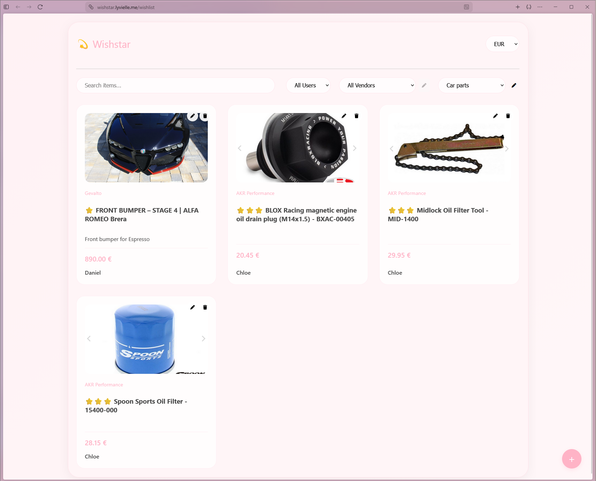
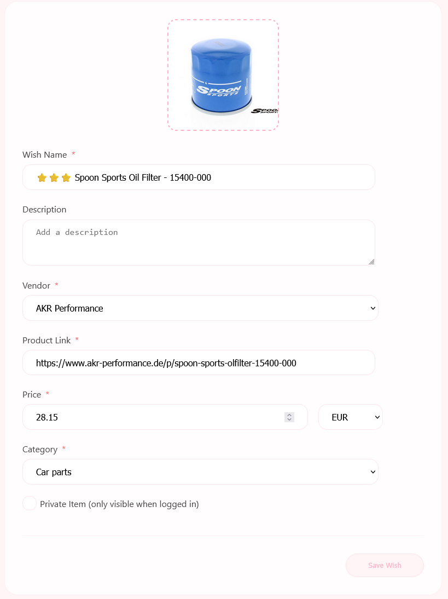
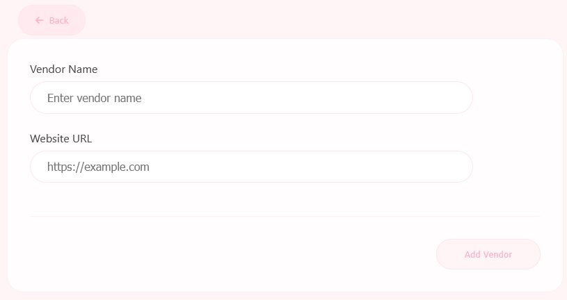
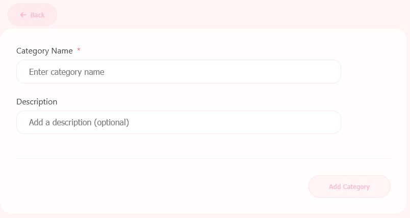

# Wishstar ⭐



A private ASP.NET-powered wishlist application for tracking desired items with detailed information and flexible organization.

## Overview

Wishstar is a lightweight, personal wishlist management system designed for small-scale private use. Built with ASP.NET, it provides a simple yet comprehensive interface for cataloging items you'd like to purchase, complete with vendor tracking, categorization, and privacy controls.

## Features

### Creating a Wish



Each wish entry includes:

- **Picture** - Visual representation of the desired item (required)
- **Name** - Title of the wish (required)
- **Rating** - How much the item is wished for, 1–5 stars (shown on every card, sortable)
- **Description** - Additional details about the item (optional)
- **Vendor** - Select an existing vendor or create a new one with the **+** button (what you typed so far is kept)
- **Product Link** - Direct URL to the item (required)
- **Price** - Item cost with multi-currency support: EUR, RSD, YEN, USD, GBP (required)
- **Category** - Organize wishes by selecting or creating categories
- **Private Item** - Checkbox to restrict visibility to logged-in users only

### Importing a Wish from a Screenshot

On the "New wish" form, **Import from screenshot** reads a screenshot of a shop page (app or browser) and
pre-fills the form:

- **Name** – the product title, shortened (the full title goes into the description)
- **Price & currency** – the current price; old/struck-through prices, shipping costs and monthly rates are ignored
- **Photo** – the product photo is cropped out of the screenshot

Everything is processed on your own server (local OCR, no external service), usually in under a second.
Nothing is saved automatically: check the suggestions, then add the product link, category and so on.

### Managing Vendors & Categories





Vendors and categories can be created on-the-fly through dedicated interfaces, allowing for flexible organization as your wishlist grows.

### Browsing & Filtering

- View all wishes in a clean list format
- Filter by search text (searches both title and description)
- Filter by user who created the wish
- Filter by specific vendors or categories
- Sort by date added, rating, price or name
- Filters and the scroll position are remembered when you open a wish and come back
- Click any wish to open its product link in a new tab
- Switch viewing currency in the upper right corner
- Changes made by the other user appear live, without reloading

### Privacy & Access Control

- Secure login with email and password
- User accounts created server-side only (no public registration)
- Edit or delete wishes when logged in (indicated by icons near each item)
- Control wish visibility with the "Private Item" toggle

### Install as an app (PWA)

Wishstar can be installed from the browser ("Add to Home Screen" on iOS/Android, the install icon in desktop
Chrome/Edge). It then runs in its own window, loads faster on repeat visits and shows a friendly page when offline.

## Technical Details

- Built with ASP.NET Core / Blazor Server on **.NET 10**
- Data is stored in JSON files, no database required
- Designed for 2-user private deployment
- Uploaded photos are auto-rotated, downscaled and stored as WebP; 480px/960px thumbnails are generated
  and cached, so the list stays fast even with large phone photos
- If the connection to the server drops (phone locked, tab in background), the app reconnects on its own;
  if the server has discarded the session it reloads silently and keeps your place in the list

### Running with Docker

```sh
SERVER_URL=wishes.example.com HOST_PORT=8080 docker compose up -d --build
```

Everything the app stores lives in the mounted volume (`/srv/wishstar/data` → `/app/app`):

| Path | Content |
| --- | --- |
| `content/cfg/*.json` | users, wishes, vendors, categories |
| `content/img/` | photos (`.cache/` holds generated thumbnails and can be deleted at any time) |
| `content/keys/` | keys that protect the login cookies – keep them, or everyone gets logged out |

### Creating users

Accounts are created by editing `content/cfg/users.json` (the app creates a placeholder user on first start).
Generate the value for the `Token` field with:

```sh
docker exec -it wishstar dotnet Wishstar.dll hash-password
```

Passwords are stored as salted PBKDF2 hashes. Older unsalted SHA-256 hashes still work and are upgraded
automatically on the next login.

---

*A simple, personal project for managing shared wishlists between partners.*
